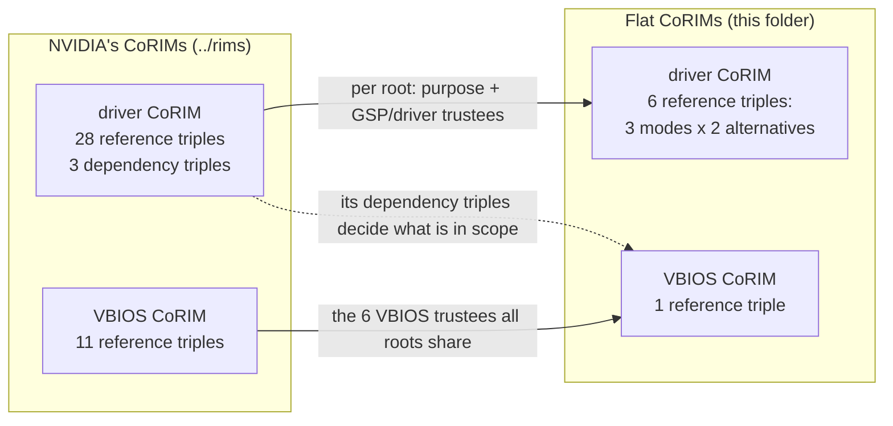

# Flat example CoRIMs (no dependency triples)

These are **derived examples, not NVIDIA's**. They are NVIDIA's two Rubin example CoRIMs rewritten for a *flat projection*. That projection
puts each GPU's evidence into two environments, which lets the same verdict be reached without
dependency triples.

They keep NVIDIA's RIM ids as file names, so the Rubin evidence's own `rim-locators` resolve them
when this folder is used as the offline RIM store. Spike scenario 5 does exactly that.

| File | Content |
| --- | --- |
| [`measurements.md`](measurements.md) | **Start here.** Every element key: which flat reference triple requires it, what it checks, and whether the Rubin evidence reports it |
| `NV_GPU_DRIVER_GR100_620.54.diag` | The driver CoRIM in annotated CBOR diagnostic notation: **6 reference triples** of 21 measurements each |
| `GR100_081D_9900230000.diag` | The VBIOS CoRIM, the same way: **1 reference triple** of 9 measurements |
| `unsigned/<rim-id>.corim` | The authoritative unsigned CoRIMs (`#6.501`), which the `.diag` files render |
| `<rim-id>.cose` | The same payloads, byte for byte, signed with the **test** key `../../keys/nvidia.rims.example.*` |

## From NVIDIA's shape to the flat shape

The spike's `FlatProjection.Compile` does the rewrite, as follows:

- **One driver reference triple per mode.** For each of the driver CoRIM's three dependency
  triples, it takes the root environment (`CC SPT` `…11.1.1`, `CC MPT` `…11.1.2`, `TDISP` `…11.1.4`)
  as the triple's environment.
  - It lists the root's `purpose` plus the reference measurement of every GSP/driver trustee,
    including the GSP boot ROM's `DiceTcbInfo`.
  - The two alternative references for `11.100.10` make it two triples per mode.
- **One firmware reference triple.** It lists the six FSP/VBIOS trustees, which all three roots
  share, under the spike-only environment `{ vendor: "NVIDIA", model: "GPU FSP/VBIOS firmware (flattened)" }`.
- **Element keys.** Each measurement's `mkey` becomes `"<environment OID under 1.3.6.1.4.1.5703.1300>/<original mkey>"`.
  For example, FLR's two digests become `1.1.11.1.10.100.7/FLRC` and `…/FLRD`. The flat evidence
  ECTs are keyed the same way, so an element-by-element match still means the same measurement.
- **Scope is the triple itself.** References outside every root's scope are left out: the VBIOS
  CoRIM's `JTGS`, `DBGS`, `BOOTS`, `L0CSVN` and its FSP layer-0 environment. Under NVIDIA's rules
  they never affect the verdict either.
- **Profile.** `corim-map.profile` is the placeholder
  `tag:example.com,2026:verifier-framework/nvidia-gpu-flat-spike`. It names the element-key
  convention, which is not standard CoRIM.

A verifier then needs only the generic rule "every evidence environment is corroborated".
Matching a flat reference triple already requires every listed measurement to be present and
equal. That is the job the dependency triples did across NVIDIA's ~30 environments.
